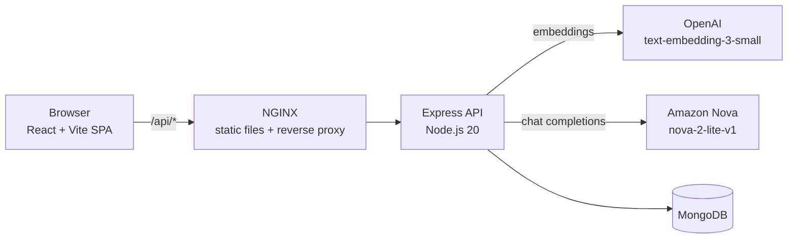

# Bimo

**Turn any document into a chatbot in seconds.**

🔗 **Live demo: [bimo.iamola.net](https://bimo.iamola.net)**

Bimo is a full-stack AI app that turns a PDF or a text, CSV or JSON file into a chatbot grounded in that document. Each bot answers questions using **retrieval-augmented generation (RAG)**: it looks up the most relevant parts of your document and answers *only* from them. If the answer isn't in the document, the bot says so instead of making something up.

> [!WARNING]
> **Do not upload sensitive documents.** Bimo is a demo project with no user accounts. Every bot, including its document text, is stored in a shared database that anyone using the app can see. Document text is also sent to third-party AI providers (OpenAI and Amazon Nova) to be processed. Never upload personal, confidential, financial, medical or proprietary information.


---

## Features

- **Bots from documents:** upload a PDF, TXT, CSV or JSON file and get a working chatbot.
- **Grounded answers:** bots answer strictly from your document and reply *"I don't have that information"* when it isn't covered.
- **Bot management:** create, revisit, chat with and delete bots. Chat history is saved with each bot.
- **Containerized:** the frontend and API each ship as a Docker image and run together with Docker Compose behind NGINX.

---

## How It Works

### Architecture



### The RAG pipeline

**1. Ingestion** (`POST /api/bot`)

1. **Extract:** PDFs are parsed on the server with `pdf-parse`. Text, CSV and JSON files are read in the browser.
2. **Chunk:** LangChain's `RecursiveCharacterTextSplitter` splits the text into overlapping chunks (512 characters, 64 overlap), so context isn't lost at chunk boundaries.
3. **Embed:** each chunk becomes a 1,536-dimension vector via OpenAI `text-embedding-3-small`.
4. **Name:** Amazon Nova generates a one-word name for the bot from the first chunks.
5. **Store:** the chunks, embeddings and an empty chat history are saved to MongoDB under a generated bot ID.

**2. Retrieval and generation** (`POST /api/chat`)

1. The user's question is embedded with the same model.
2. **Cosine similarity** ranks every chunk against the question, and the **top 3** are kept as context.
3. Amazon Nova answers using a strict system prompt: answer only from the given context, in two sentences at most, and decline when the answer isn't there.

---

## Tech Stack

| Layer | Technologies |
|---|---|
| **Frontend** | React 19, TypeScript, Vite, Tailwind CSS 4, shadcn/ui (Radix), React Router, Sonner |
| **Backend** | Node.js 20, Express 5, Multer, pdf-parse |
| **AI / RAG** | LangChain (text splitters, OpenAI embeddings), OpenAI `text-embedding-3-small`, Amazon Nova `nova-2-lite-v1` (OpenAI-compatible API) |
| **Database** | MongoDB |
| **Infrastructure** | Docker, Docker Compose, NGINX (SPA hosting and reverse proxy), Alpine-based images |

---

## API Reference

| Method | Endpoint | Description |
|---|---|---|
| `POST` | `/api/bot` | Create a bot from an uploaded PDF (`multipart/form-data`, field `file`) or raw text (`doc`) |
| `GET` | `/api/bot` | List bots |
| `GET` | `/api/bot/:id` | Get one bot |
| `PUT` | `/api/bot/:id` | Update a bot (for example, its chat history) |
| `DELETE` | `/api/bot/:id` | Permanently delete a bot and its data |
| `POST` | `/api/chat` | Ask a bot a question and get a grounded answer |
| `POST` | `/api/feedback` | Submit user feedback |

---

## Getting Started

### Prerequisites
- Docker with Docker Compose, **or** Node.js 20+
- A MongoDB connection string (MongoDB Atlas works)
- An OpenAI API key (for embeddings) and an Amazon Nova API key (for chat)

### 1. Clone the repo
```bash
git clone https://github.com/Olamide-Olosunde/Bimo.git && cd Bimo
```

### 2. Configure environment variables

Create `backend/.env.list`. Docker Compose reads it, so use plain `KEY=value` lines with no spaces around `=`:

```env
admin_connection_string=mongodb+srv://<user>:<password>@<cluster>/
OPEN_AI_API_KEY=sk-...
NOVA_AI_API_KEY=...
DEV_URL=http://localhost:5173
PROD_URL=http://localhost:8080
```

`DEV_URL` and `PROD_URL` are the origins the backend allows for CORS.

### 3a. Run with Docker (recommended)

```bash
# Build the images
docker build -t bimo_be_local:v1 ./backend
docker build --build-arg VITE_BACKEND=http://localhost:3000 -t bimo_fe_local:v1 ./frontend

# Start everything
docker compose up -d
```

- App: **http://localhost:8080**
- API: **http://localhost:3000**

### 3b. Run locally for development

```bash
# Backend (reads backend/.env)
cd backend && npm install && node src/server.js

# Frontend (in a second terminal)
cd frontend
echo "VITE_BACKEND=http://localhost:3000" > .env
npm install && npm run dev
```

Open **http://localhost:5173**.

---

## Project Structure

```
Bimo/
├── backend/
│   ├── src/server.js
│   ├── dockerfile
│   └── .dockerignore
├── frontend/
│   ├── src/
│   │   ├── Pages/
│   │   ├── Components/
│   │   └── lib/
│   ├── nginx.conf
│   └── dockerfile
└── docker-compose.yaml
```

---

## Roadmap

- [ ] User accounts, with bots scoped to their owners
- [ ] **Bring your own key (BYOK)** for OpenAI-compatible providers
- [ ] Server-side retrieval: load embeddings from MongoDB instead of sending them with every request
- [ ] Vector search with MongoDB Atlas Vector Search, for large documents
- [ ] Streaming responses and source citations in answers
- [ ] Rate limiting and request-size hardening

---

## Author

**Olamide Olosunde**, Software Engineering & AI student at Dakota State University

[GitHub](https://github.com/Olamide-Olosunde) · [LinkedIn](https://www.linkedin.com/in/olamide-olosunde-42a9b32aa) · [olamide.olosunde1@gmail.com](mailto:olamide.olosunde1@gmail.com)
